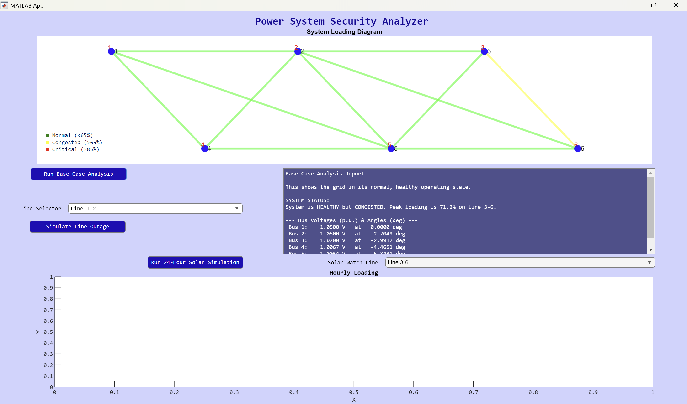
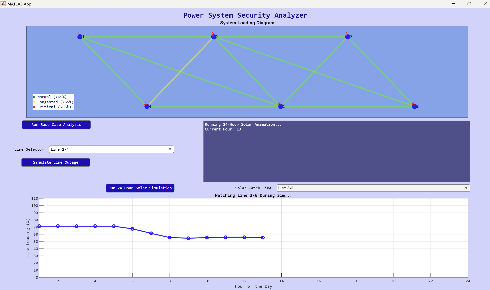
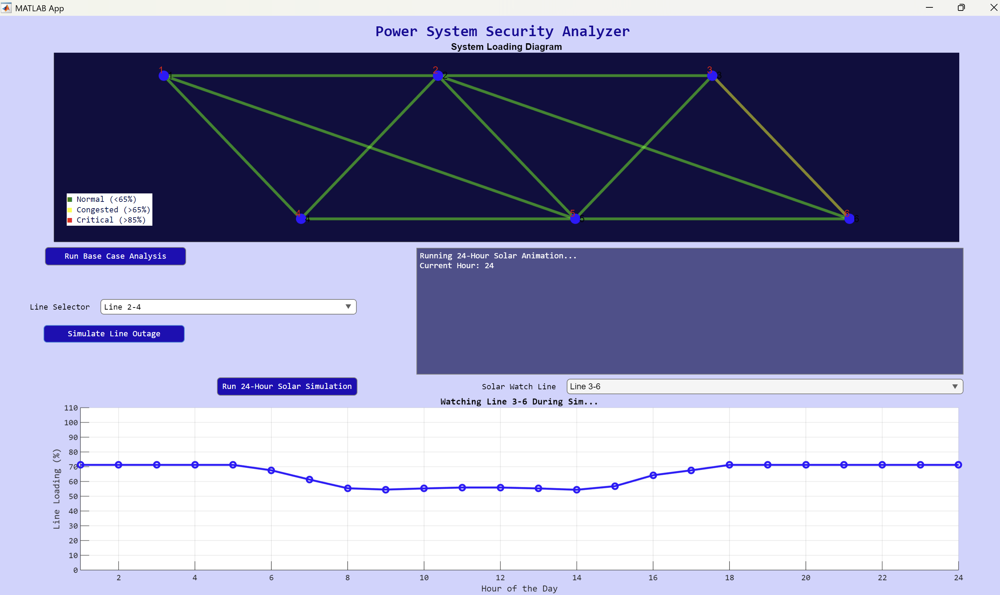

# GridSentry: Power System Security Analyzer

GridSentry is an interactive MATLAB App Designer application for studying the security of a small transmission grid. It models a 6-bus power system and lets you:

- run a **base-case power flow**,
- knock out any transmission line to test **N-1 security**, and
- watch a **150 MW solar farm** change line loadings over a simulated 24-hour day.

The app is a modern, interactive version of the Master's thesis *"Increasing the Line Security by Using the Sensitivity Analyses"* (S. Aşiksoy, NEU, 2010). That work was done with static calculations. GridSentry rebuilds it as a visual tool where you click a button and immediately see which lines are under stress.



---

## Table of Contents

- [What it does](#what-it-does)
- [How I built it](#how-i-built-it)
  - [1. Modelling the grid](#1-modelling-the-grid)
  - [2. Solving the power flow](#2-solving-the-power-flow)
  - [3. Measuring line loading](#3-measuring-line-loading)
  - [4. Drawing the grid](#4-drawing-the-grid)
  - [5. N-1 contingency analysis](#5-n-1-contingency-analysis)
  - [6. 24-hour solar integration](#6-24-hour-solar-integration)
  - [7. Turning numbers into conclusions](#7-turning-numbers-into-conclusions)
  - [8. Packaging as a desktop app](#8-packaging-as-a-desktop-app)
- [Getting started](#getting-started)
- [Using the app](#using-the-app)
- [Repository structure](#repository-structure)
- [Possible extensions](#possible-extensions)
- [License](#license)

---

## What it does

| Feature | What you get |
|---|---|
| **Base Case Analysis** | Solves the AC power flow for the grid's normal operating state. Reports each bus's voltage magnitude and angle, plus the most heavily loaded line. |
| **Line Outage Simulation (N-1)** | Pick any of the 11 lines from a dropdown and take it out of service. The power flow is re-solved and the app reports whether the grid is still secure. |
| **Color-coded loading diagram** | Each line is drawn green (< 65%), yellow (> 65%, congested) or red (> 85%, critical) according to its loading. |
| **24-Hour Solar Simulation** | Adds a 150 MW solar plant at Bus 6 and steps through a daily irradiance profile one hour at a time. The diagram is animated and the background shifts from night to day and back. A live chart tracks a line you choose. |
| **Automatic text reports** | Every analysis ends with a plain-language conclusion, e.g. *"Grid is NOT N-1 SECURE. Critical overload of XX% on Line A-B."* |
| **Standalone installer** | Packaged with MATLAB Compiler, so the app can run on machines without a MATLAB license (using the free MATLAB Runtime). |

---

## How I built it

The whole app is one App Designer class, [`GridSentry.mlapp`](GridSentry.mlapp) (MATLAB R2024b). It uses [MATPOWER](https://matpower.org/) as the power flow engine. The sections below explain each part.

### 1. Modelling the grid

When the app starts (`startupFcn`), it builds the test system as a MATPOWER case struct (`mpc`) with a 100 MVA base:

- **3 generator buses**
  - Bus 1 is the slack bus, held at 1.05 p.u.
  - Bus 2 is a PV bus producing 50 MW at 1.05 p.u.
  - Bus 3 is a PV bus producing 60 MW at 1.07 p.u.
- **3 load buses**: Buses 4, 5 and 6, each drawing 70 MW + 70 MVAr.
- **11 transmission lines**, each with its own resistance, reactance and line charging, and each rated at **100 MVA**.

| Line | R (p.u.) | X (p.u.) | B (p.u.) |
|---|---|---|---|
| 1-2 | 0.0010 | 0.20 | 0.04 |
| 1-4 | 0.0005 | 0.20 | 0.04 |
| 1-5 | 0.0008 | 0.30 | 0.06 |
| 2-3 | 0.0005 | 0.25 | 0.06 |
| 2-4 | 0.0005 | 0.10 | 0.02 |
| 2-5 | 0.0010 | 0.30 | 0.04 |
| 2-6 | 0.0007 | 0.20 | 0.05 |
| 3-5 | 0.0012 | 0.26 | 0.05 |
| 3-6 | 0.0002 | 0.10 | 0.02 |
| 4-5 | 0.0020 | 0.40 | 0.08 |
| 5-6 | 0.0010 | 0.30 | 0.06 |

The case is stored in an app property, `app.mpc`, so every analysis starts from the same clean model. Both dropdowns are filled automatically from the branch table (`Line 1-2`, `Line 1-4`, ...). This means changing the network only requires editing that one table.

### 2. Solving the power flow

Each analysis calls MATPOWER's `runpf`, which solves the full AC power flow using Newton-Raphson. Summary printing is turned off with `mpoption('OUT_ALL', 0)` so the solver doesn't flood the console. The app checks `results.success`. If the solver fails to converge, the app treats that as a **system collapse**, not as a crash.

### 3. Measuring line loading

For every line, the app computes the apparent power at both ends from MATPOWER's result columns:

```matlab
S_from = sqrt(Pf.^2 + Qf.^2);           % branch columns 14, 15
S_to   = sqrt(Pt.^2 + Qt.^2);           % branch columns 16, 17
loading_pct = max(S_from, S_to) ./ rateA * 100;
```

It uses the larger of the two ends as the line's loading. This is the conservative choice, because losses make the two ends differ.

### 4. Drawing the grid

The one-line diagram is a MATLAB `graph` object plotted on `UIAxes`. The buses sit at fixed coordinates in two rows: generators 1-2-3 on top and loads 4-5-6 below. A helper method, `plotGrid(app, results)`, redraws the diagram:

- With no results, lines are drawn thin and black.
- With results, a per-edge RGB matrix is built from the loading thresholds and applied in a single `p.EdgeColor = EdgeColors` call.

A small HTML-formatted label serves as the legend.

### 5. N-1 contingency analysis

N-1 security means the grid must survive the loss of any single element. To simulate an outage, the app:

1. Copies the base case.
2. Sets the selected line's status column (`branch(:, 11)`) to `0`.
3. Re-runs the power flow.

The report lists post-outage bus voltages and angles in a table. It then finds the most heavily loaded remaining line and gives a verdict:

- **> 85%**: *NOT N-1 SECURE*, naming the overloaded line.
- **> 65%**: *SECURE but with reduced margins*.
- **Otherwise**: *SECURE*.
- **Power flow fails to converge**: *NOT N-1 SECURE: system collapse*.

### 6. 24-hour solar integration

This module tests how variable renewable generation affects line security:

1. A fourth generator, the solar farm (150 MW peak), is added at **Bus 6**.
2. A 24-value irradiance profile scales its output each hour. Output is zero overnight, ramps up from 06:00, peaks at 100% around 11:00-12:00, and falls back to zero by 18:00.
3. For each hour, the app:
   - solves the power flow,
   - stores every line's loading in a `11 × 24` matrix,
   - recolors the grid diagram,
   - sets the diagram background to a precomputed night → day → night color gradient,
   - extends the live chart for the line selected under **Solar Watch Line**,
   - and pauses for one second (`pause(1)`), so the day plays out as an animation.
4. At the end, the matrix is analysed to find:
   - the single worst line-hour,
   - every line that went over 65% and when it peaked,
   - an overall conclusion about whether the solar farm is safe for the grid.

   The final chart plots the watched line against the most critical line.

| Mid-day (hour 13) | End of day (hour 24) |
|---|---|
|  |  |

In the default case, solar output at Bus 6 relieves Line 3-6 during the day. Its loading drops from about 71% (congested) at night to about 55% around midday.

### 7. Turning numbers into conclusions

All three analyses use the same thresholds as the diagram colors (65% congested, 85% critical). This keeps the written reports consistent with the picture. The aim was for someone without power-systems training to understand the result from the report alone.

### 8. Packaging as a desktop app

[`SecurityApp.prj`](SecurityApp.prj) is a MATLAB Compiler project. It builds a standalone Windows installer named **GridSentry v1.0**. The installer downloads the MATLAB Runtime from the web during setup, so end users don't need MATLAB.

---

## Getting started

### Requirements

- **MATLAB R2024b** or newer, with App Designer
- **MATPOWER** (7.x recommended), installed and on your MATLAB path
- *(Optional)* **MATLAB Compiler**, only needed to rebuild the standalone installer

### Run from MATLAB

```matlab
% 1. Install MATPOWER and add it to the path (one time)
addpath(genpath('path/to/matpower'));   % or run install_matpower

% 2. Clone this repository and launch the app
cd path/to/gridsentry
GridSentry
```

You can also open `GridSentry.mlapp` in App Designer and press **Run**.

### Build the standalone installer

1. Open `SecurityApp.prj` in MATLAB. This opens the Application Compiler.
2. Click **Package**.
3. The installer is written to `SecurityApp_1/for_redistribution/`.

## Using the app

1. **Run Base Case Analysis**: view the grid in its normal state. In the default case, Line 3-6 is congested at about 71%.
2. **Line Selector → Simulate Line Outage**: choose a line, take it out, and read the N-1 verdict in the report panel.
3. **Solar Watch Line → Run 24-Hour Solar Simulation**: choose a line to monitor, then watch the 24-hour animation. It takes about 24 seconds. The final report appears when it finishes.

---

## Repository structure

```
gridsentry/
├── GridSentry.mlapp      # App Designer app: UI, grid model and all analysis logic
├── SecurityApp.prj       # MATLAB Compiler project for the standalone installer
├── images/               # Screenshots and app icon
│   ├── AppIcon.png
│   ├── BaseCaseAnalysis.png
│   ├── 24HourSolarSimulation.png
│   └── LineOutageSimulation.png
├── LICENSE               # MIT
└── README.md
```

## Possible extensions

- Automatic N-1 screening that loops over every line and ranks contingencies by severity
- Sensitivity factors (PTDF/LODF) to predict post-outage flows without re-solving, in the spirit of the original thesis
- Export of reports to CSV or PDF
- Loading other MATPOWER cases (IEEE 14-bus, 30-bus, ...) from a file picker
- Voltage-limit checks alongside thermal limits

## License

Released under the [MIT License](LICENSE). © 2025 Azra Asiksoy.
